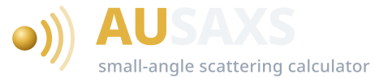
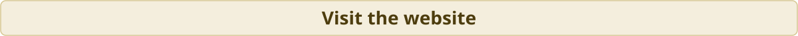
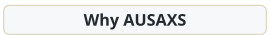
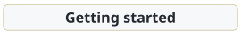
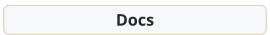
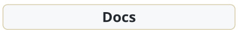
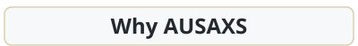
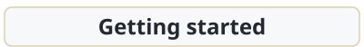

<h1 align="center">


</h1>

[](https://github.com/AUSAXS/AUSAXS/releases/latest)
[](https://pypi.org/project/pyausaxs/)
[](https://scan.coverity.com/projects/ausaxs-ausaxs)
[](LICENSE)

**AUSAXS** is a fast small-angle scattering calculator. It predicts both SAXS and SANS profiles of proteins and other biomolecules, fits them to experimental data, and ships a general-purpose Debye kernel for CPU and GPU. Available as a command-line program and a Python package on Linux, macOS and Windows.

<div align="center">
<a href="https://ausaxs.github.io/"></a>
</div>
<div align="center">
<a href="https://ausaxs.github.io/why-ausaxs/"></a><a href="https://ausaxs.github.io/getting-started/installation/"></a><a href="https://ausaxs.github.io/documentation/"></a>
</div>

```bash
python -m pip install pyausaxs
```

<!-- BUTTON-TEST-START: temporary, delete after choosing a variant -->
# Button test (temporary)

**A: markdown links + gh-*-mode-only**

[](https://ausaxs.github.io/)[](https://ausaxs.github.io/)

[](https://ausaxs.github.io/why-ausaxs/)[](https://ausaxs.github.io/why-ausaxs/)[](https://ausaxs.github.io/getting-started/installation/)[](https://ausaxs.github.io/getting-started/installation/)[](https://ausaxs.github.io/documentation/)[](https://ausaxs.github.io/documentation/)

**B: `<picture>` inside `<a>` (follows OS setting)**

<div align="center">
<a href="https://ausaxs.github.io/"><picture><source media="(prefers-color-scheme: dark)" srcset="https://raw.githubusercontent.com/AUSAXS/AUSAXS/media/btn_website-dark.svg"></picture></a>
</div>
<div align="center">
<a href="https://ausaxs.github.io/why-ausaxs/"><picture><source media="(prefers-color-scheme: dark)" srcset="https://raw.githubusercontent.com/AUSAXS/AUSAXS/media/btn_why-dark.svg"></picture></a><a href="https://ausaxs.github.io/getting-started/installation/"><picture><source media="(prefers-color-scheme: dark)" srcset="https://raw.githubusercontent.com/AUSAXS/AUSAXS/media/btn_start-dark.svg"></picture></a><a href="https://ausaxs.github.io/documentation/"><picture><source media="(prefers-color-scheme: dark)" srcset="https://raw.githubusercontent.com/AUSAXS/AUSAXS/media/btn_docs-dark.svg"></picture></a>
</div>

**C: single mid-tone outline image (no switching)**

<div align="center">
<a href="https://ausaxs.github.io/"></a>
</div>
<div align="center">
<a href="https://ausaxs.github.io/why-ausaxs/"></a><a href="https://ausaxs.github.io/getting-started/installation/"></a><a href="https://ausaxs.github.io/documentation/"></a>
</div>

**D: single SVG with its own prefers-color-scheme (follows OS setting)**

<div align="center">
<a href="https://ausaxs.github.io/"></a>
</div>
<div align="center">
<a href="https://ausaxs.github.io/why-ausaxs/"></a><a href="https://ausaxs.github.io/getting-started/installation/"></a><a href="https://ausaxs.github.io/documentation/"></a>
</div>
<!-- BUTTON-TEST-END -->

# Features
- **[SAXS fitting](https://ausaxs.github.io/documentation/cli/fit/)** and **[SANS fitting](https://ausaxs.github.io/documentation/cli/sans/)** with explicit hydration shell and excluded volume
- **[EM map validation](https://ausaxs.github.io/documentation/cli/em-validation/)** against SAXS data
- **[Rigid-body refinement](https://ausaxs.github.io/documentation/cli/rigidbody/)** _(in development)_
- **Debye scattering** of crystals and arbitrary point scatterers through the [Python package](https://github.com/AUSAXS/pyAUSAXS)
- **GPU acceleration** for NVIDIA and AMD cards

AUSAXS is the fastest SAS program available: millions of atoms in seconds on consumer GPUs, hundreds of thousands on the CPU. See the [benchmarks](https://ausaxs.github.io/why-ausaxs/#speed).

# Installation
`pip install pyausaxs` installs the `ausaxs` command-line tool and the Python API. Precompiled binaries are available from the [releases](https://github.com/AUSAXS/AUSAXS/releases), or you can [build from source](https://ausaxs.github.io/getting-started/compiling/). Python examples are in the [pyAUSAXS repository](https://github.com/AUSAXS/pyAUSAXS/tree/master/examples).

# Contributing
Encountering problems, have feedback or suggestions, or considering contributing? Please check out the [contributor guidelines](CONTRIBUTING.md).

# References
- [Small-angle X-ray scattering profile calculation for high-resolution models of biomacromolecules](https://doi.org/10.1107/S160057672500562X) (_J. Appl. Cryst._ 2025)
- [Validation of electron-microscopy maps using solution small-angle X-ray scattering](https://doi.org/10.1107/S2059798324005497) (_Acta Cryst. D_ 2024)
- [Small-angle solution scattering: from fundamental theory to practical approximations](https://doi.org/10.1088/1361-6633/aead1d) (_Rep. Prog. Phys._ 2026)

_This project is licenced under the GNU Lesser General Public Licence v3.0. Supported by grants DFF 1026-00209B and DFG HU 1971/3-2._
